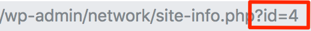
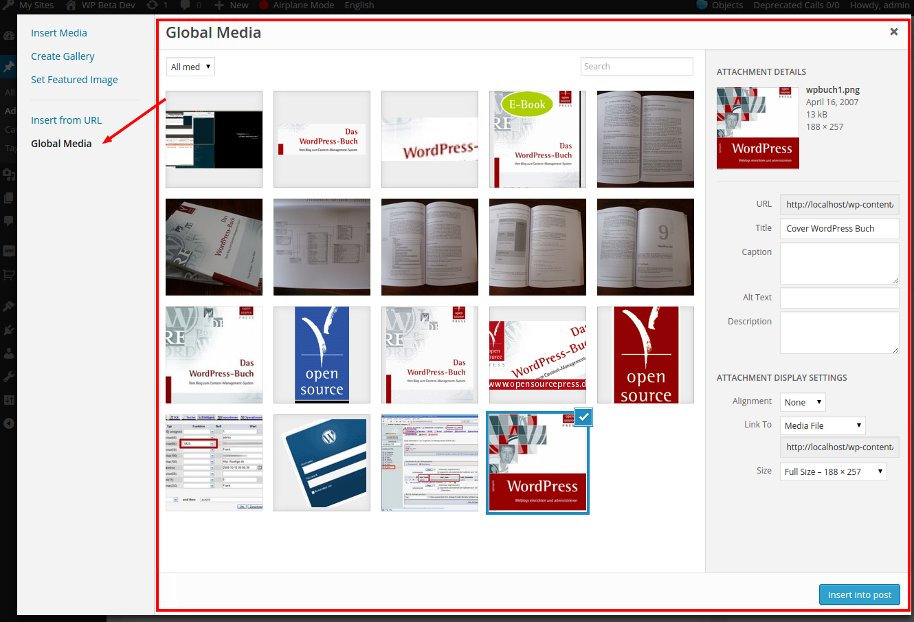
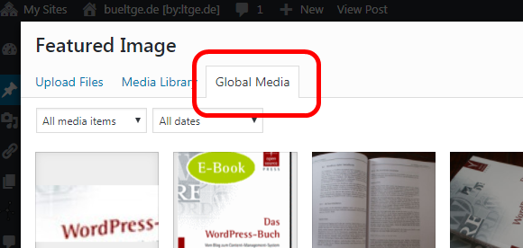

# Multisite Global Media

[](https://github.com/bueltge/multisite-global-media/actions/workflows/continuous-integration.yml)
[](https://scrutinizer-ci.com/g/bueltge/multisite-global-media/?branch=master)
[](https://packagist.org/packages/bueltge/multisite-global-media)
[](./LICENSE)

_Multisite Global Media_ is a WordPress plugin that shares media across the Multisite network.

## Description
This small plugin adds a new tab to the media library, which allows you to share media from one site to all the other sites of the network. By default, the Site ID is set to `1`. You can change this Site ID via the filter hook `global_media.site_id`, see [Set your Site ID for the Global Media Library](#set-your-site-id-for-the-global-media-library).

Global media can be used in
* the media modal of the editor (insert into content, responsive images),
* the featured image of posts,
* the REST API (featured image of posts),
* the WooCommerce product gallery,
* the ACF image field.

To get Global Media to work, please follow these steps:

1. Decide which site will host the shared media for the network.
2. Add media to the media library of the chosen site.
3. Find the Site ID of your chosen site by going to your Network Admin. In the left-hand menu, choose "All Sites", and then click on "Edit" under the site you need. In the address bar, you will see `site-info.php?id=4` where the last number is the ID.



4. If the Site ID of your chosen site is `1`, then you don't need to make any changes. If it's a different ID, please read the section below about changing the Site ID via hook.

Note: A useful enhancement in the Multisite context is the plugin [Multisite Enhancements](https://github.com/bueltge/wordpress-multisite-enhancements). It also helps to identify the site and its Site ID.

## Requirements
* WordPress Multisite
* PHP 8.3 or higher

## Set your Site ID for the Global Media Library
If you need to change the default Site ID `1` to another value, create a small [Must Use plugin](https://developer.wordpress.org/advanced-administration/plugins/mu-plugins/).

1. Create the file `/wp-content/mu-plugins/mgm-set-my-site-id.php`. WordPress loads only PHP files placed directly in `mu-plugins`, not in sub-directories.
2. Add the following content and change the return value to your chosen Site ID.

```php
<?php
/**
 * Plugin Name: Multisite Global Media Site ID
 * Plugin URI:  https://github.com/bueltge/multisite-global-media/
 * Description: Set my Multisite Global Media site in the network.
 * Version:     1.0.0
 * Network:     true
 */

add_filter( 'global_media.site_id', static function (): int {
    return 1234;
} );
```

3. Activation is not necessary, Must Use plugins are always active.

## Installation
### Manual
* Download `multisite-global-media.zip` from the assets of the latest [release](https://github.com/bueltge/multisite-global-media/releases/latest). This zip is ready to use and contains the autoloader, no Composer required. The automatically generated `Source code` archives do not work without Composer.
* Upload the zip via Network Admin > Plugins > Add New > Upload Plugin, or use Composer, see below.
* Install the plugin in your environment, recommended as [Must Use plugin](https://developer.wordpress.org/advanced-administration/plugins/mu-plugins/).
* Optional: The [Must Use Loader](https://github.com/bueltge/must-use-loader) is helpful if you use more than one Must Use plugin stored in sub-directories.
* Set the Site ID for the Global Media Library, see [above](#set-your-site-id-for-the-global-media-library).
* Activate the plugin for the whole network if you don't store it as Must Use plugin.

### Composer
The plugin is also available as [Composer package](https://packagist.org/packages/bueltge/multisite-global-media).

```bash
composer require bueltge/multisite-global-media
```

## Screenshots




## Contributing
Contributions are what makes the open-source community such an amazing place to learn, inspire, and create. Any contributions you make are **greatly appreciated**.

1. Fork the Project
2. Create your Feature Branch (`git checkout -b feature/AmazingFeature`)
3. Run the checks (`composer qa` runs PHPUnit, PHPCS and PHPStan)
4. Commit your changes (`git commit -m 'Add some AmazingFeature'`)
5. Push to the Branch (`git push origin feature/AmazingFeature`)
6. Open a Pull Request

See [DEVELOPMENT.md](./DEVELOPMENT.md) for the local Docker environment.

## Other Notes

### Bugs, technical hints or contribute
Please give feedback, contribute and file technical bugs as [issues](https://github.com/bueltge/multisite-global-media/issues) in this repository.

### License
Good news, this plugin is free for everyone! It's released under the [GPLv2+](./LICENSE).

### Contact & Feedback
The plugin is designed and developed by [Frank](https://bueltge.de) and team members from the [Syde](https://syde.com/) crew. Special thanks and praise to Dominik Schilling and Guido Scialfa for their help and engagement.

Please let me know if you like the plugin or you hate it or whatever.

Please fork it and improve the plugin, see the contributing note above. Add an issue for ideas and bugs. We also say thank you for improvements in the documentation and help in the support.